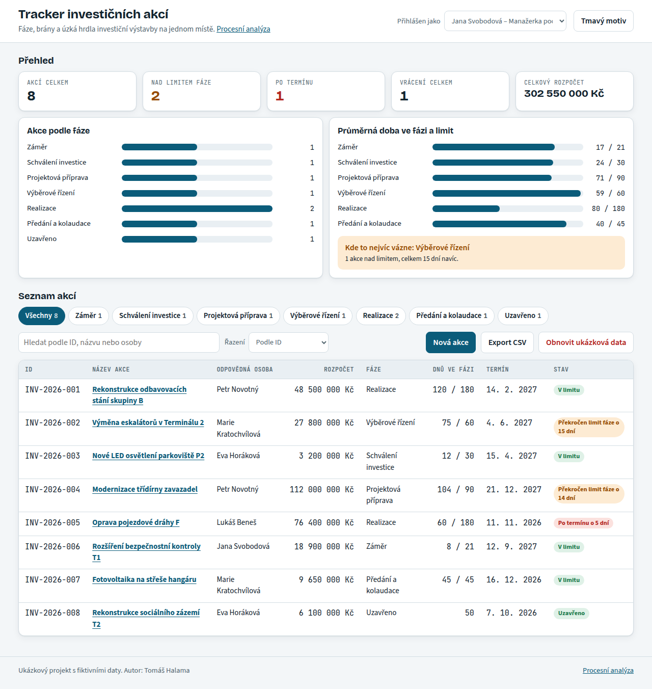

# Tracker investičních akcí

Ukázková webová aplikace pro sledování investičních akcí (například na letišti) podle fází procesu. Je to nezávislý ukázkový projekt s fiktivními daty, ne oficiální nástroj žádné organizace.



## Proč to vzniklo (problém a řešení)

| Problém dnes | Jak ho řeší aplikace |
|---|---|
| Stav akcí žije v e-mailech a různých Excelech | Jeden přehled všech akcí, fází, rozpočtů a termínů |
| Nejasné, kdo schvaluje a co je potřeba | Každá fáze má kontrolní seznam brány |
| Chybějící dokument se zjistí až při předání | Posun do další fáze je zakázaný, dokud brána není splněná, a aplikace řekne, co chybí |
| Nikdo nevidí, kde akce stojí | Limity dní u fází, štítky „nad limitem“ a „po termínu“, přehled „kde to nejvíc vázne“ |
| Nejde dohledat, proč se akce vrátila | Vrácení vyžaduje důvod, vše je v auditní stopě |

Podrobný rozbor AS-IS a TO-BE s diagramem fází a měřítky úspěchu je na stránce [docs/proces.html](docs/proces.html).

## Funkce

- Sedm fází (stage-gate): Záměr, Schválení investice, Projektová příprava, Výběrové řízení, Realizace, Předání a kolaudace, Uzavřeno.
- Seznam akcí s filtrem podle fáze, hledáním (bez ohledu na diakritiku) a řazením.
- Kontrolní seznam brány u každé fáze, tlačítko „Posunout do další fáze“ je zakázané, dokud něco chybí.
- Vrácení do předchozí fáze s povinným důvodem.
- Limit dní u každé fáze: oranžový štítek po překročení limitu, červený po termínu dokončení.
- Přehled: počty akcí ve fázích, akce nad limitem a po termínu, počet vrácení, celkový rozpočet, průměrná doba ve fázi, „kde to nejvíc vázne“.
- Detail akce s auditní stopou (kdo, kdy, co). Uživatel se volí v seznamu „Přihlášen jako“ (bez hesla).
- Nová akce s validací formuláře.
- Export CSV (UTF-8 s BOM, oddělovač středník) aktuálně zobrazeného seznamu.
- Světlý a tmavý motiv, mobilní zobrazení od 400 px (na úzkém displeji karty místo tabulky).
- Data v `localStorage`, tlačítko „Obnovit ukázková data“.

## Jak spustit

Aplikace je jeden soubor bez sestavení. Otevřete `docs/index.html` v prohlížeči, nebo ji nasaďte na GitHub Pages (zdroj: složka `/docs`).

Pro deterministické chování lze datum „dnes“ přepsat: `docs/index.html?dnes=2026-11-16` (nebo `window.__TODAY__`).

## Jak spustit testy

```bash
npm install
npx playwright install chromium
npm test
```

Testy běží proti `docs/index.html` přes `file://` s pevným datem „dnes“ 16. 11. 2026. Pokud máte nainstalovaný vlastní Chrome, nastavte `PW_CHROME=/usr/bin/google-chrome`. Na GitHubu je spouští workflow `.github/workflows/tests.yml` při každém pushi a pull requestu.

## Testovací scénáře

| ID | Typ | Scénář | Očekávaný výsledek |
|---|---|---|---|
| TC-01 | negativní | Posun do další fáze, když chybí dokument | Tlačítko je zakázané, hláška uvádí, co chybí |
| TC-02 | pozitivní | Zaškrtnutí posledního dokumentu a posun | Akce je v další fázi, posun je v historii |
| TC-03 | hraniční | Odškrtnutí dokumentu po splnění brány | Posun je znovu zakázán, změna je v auditní stopě |
| TC-04 | negativní | Vrácení bez důvodu | Chyba „Uveďte důvod vrácení“, fáze se nezmění |
| TC-05 | pozitivní | Vrácení s důvodem | Akce je v předchozí fázi, důvod v historii, počet vrácení vzroste |
| TC-06 | negativní | Důvod vrácení obsahuje HTML | Text se zobrazí doslova, nevykoná se |
| TC-07 | hraniční | 29, 30 a 31 dní ve fázi s limitem 30 | Štítek „Překročen limit“ jen při 31 dnech |
| TC-08 | pozitivní | Akce po termínu a nad limitem | Červený a oranžový štítek se správným počtem dní |
| TC-09 | hraniční | Termín dokončení je přesně dnes | Akce ještě není po termínu |
| TC-10 | negativní | Odeslání prázdného formuláře | Chyby u všech čtyř polí |
| TC-11 | hraniční | Název se 4 a s 5 znaky | 4 znaky odmítnuty, 5 znaků projde |
| TC-12 | negativní | Rozpočet 0, záporný, text | Chyba „Rozpočet musí být kladné číslo.“ |
| TC-13 | hraniční | Termín včera a dnes | Včera odmítnuto, dnes projde |
| TC-14 | pozitivní | Platná nová akce | Vznikne ve fázi Záměr, částka ve tvaru 1 250 000 Kč |
| TC-15 | pozitivní | Filtr podle fáze | Zobrazí se jen akce dané fáze |
| TC-16 | pozitivní i negativní | Hledání „tridirny“ a neexistující výraz | Nalezena „Modernizace třídírny“, jinak prázdný stav |
| TC-17 | pozitivní | Přehled | Počty, rozpočet a „kde to vázne“ odpovídají datům |
| TC-18 | pozitivní | Řazení podle rozpočtu | Nejvyšší rozpočet je první |
| TC-19 | pozitivní | Export CSV | BOM, hlavička, středníky, diakritika, 8 řádků dat |
| TC-20 | pozitivní | Obnovení stránky | Změna zůstane |
| TC-21 | pozitivní | Obnovení ukázkových dat | Vrátí se původní stav |
| TC-22 | negativní | Zrušení potvrzení obnovení | Data i filtr zůstanou |
| TC-23 | pozitivní | Odkaz na procesní analýzu a zpět | Obě stránky se zobrazí |
| TC-24 | pozitivní | Přepínač motivu | Motiv se přepne a zapamatuje |
| TC-25 | pozitivní | Vrácení do předchozí fáze po posunu | Dříve splněné dokumenty zůstanou zaškrtnuté, posun je znovu povolen |

TC-07 (3 hodnoty) a TC-12 (3 hodnoty) jsou parametrizované, celkem tedy 29 běhů.

## Struktura

```
docs/index.html     aplikace (HTML, CSS a JS v jednom souboru)
docs/proces.html    procesní analýza AS-IS a TO-BE
tests/              Playwright testy
.github/workflows/  spouštění testů na GitHubu
snimky/             snímky obrazovky (400 px a 1280 px, světlý a tmavý motiv)
```

Ukázkový projekt s fiktivními daty. Autor: Tomáš Halama
